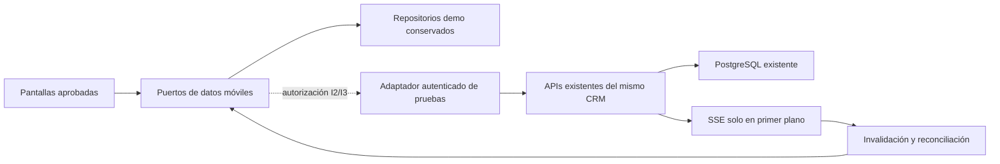

# Arquitectura propuesta · conservar backend y diseño

## Autenticación Android/iOS

La primera opción para I2 es **reutilizar Better Auth y las mismas cuentas**, no desarrollar otro sistema de contraseñas. Primero un prototipo con cookies en un backend aislado: login de biblioteca, get-session y sign-out a través del handler existente. Los nombres de cookie y los detalles de renovación deben obtenerse de la versión 1.7.19 en staging; no se copian del navegador ni se inventan. Verificar Set-Cookie, múltiples cookies, expiración/rotación, dominio, HTTPS, redirecciones y rechazo de orígenes no confiables. CORS de navegador y cabeceras Origin/CSRF de Better Auth son asuntos distintos; React Native no queda autorizado por «no tener CORS».

Guardar solo material de sesión mediante SecureStore y un puerto CredentialVault, vinculado a entorno/origen/instalación. Nunca guardar la contraseña ni tokens/cookies en AsyncStorage, logs, archivos de prueba, query strings o URLs de imagen. Evitar dos autoridades contradictorias entre un cookie jar nativo y el almacenamiento explícito. Procesar las renovaciones de cookie en forma serializada y single-flight, volver a validar al primer plano y tras 401; no repetir operaciones de escritura por recuperar la sesión. Verificar qué respuestas efectivamente transportan la renovación (una llamada server-side getSession no acredita por sí sola que el cliente haya recibido Set-Cookie).

El cliente `better-auth/react` web y sus providers no deben importarse al móvil. Si las pruebas demuestran que hace falta `@better-auth/expo` u otro adaptador oficial, evaluar la versión compatible; puede exigir configuración/plugins del servidor y orígenes confiables. **No está instalado ni autorizado fuera de apps/mobile**. No habilitar indiscriminadamente esquemas de URL, wildcard de origen o registro público para hacerlo funcionar. Un login OAuth/PKCE móvil específico sería una alternativa posterior solo si reutilizar cookies resulta inadecuado, reutilizando la autoridad existente y con endpoints/alcances móviles propios; el OAuth MCP actual no se recicla sin cambios.

Falta un bootstrap JSON estable de contexto móvil que entregue usuario, organización activa verificada, membresías habilitadas, permisos/delegaciones, módulos, expiración y capacidades de sincronización. Es una **propuesta de servidor**, no un `/api/me` ya existente. No derivar permisos de etiquetas de UI ni de roles guardados hace días. El cambio de organización debe ser una operación de servidor que compruebe membresía y rote/actualice contexto; el plugin organization actual está bloqueado, así que no se promete cambio multiempresa real hoy.

Al cerrar sesión: cancelar suscripciones/requests, incrementar generación, borrar secretos y caché del ámbito, retirar avisos, y revocar sesión en servidor cuando haya conexión. Si está offline, borrar autoridad local de inmediato, pero no declarar revocación remota hasta confirmación; una credencial robada puede seguir válida. En dispositivo perdido hacen falta revocación de sesiones/instalaciones y un procedimiento administrativo probado; no puede garantizarse borrar el caché de un teléfono sin conexión.

Enlaces de acceso: conservar el flujo administrativo de `/api/account-link/[token]`, TTL/un solo uso y errores 410/422/429; no activar el reset de correo deshabilitado ni copiar el enlace a logs/analítica. Probar deep link y no consumirlo por el simple preview. Registro público sigue cerrado salvo política explícita del servidor.

## Datos y sincronización progresiva

I1 solo añade puertos y una simulación independiente: **no se cambia la selección de proveedor de las pantallas**. Ni login, Bandeja, Chat ni T-M5B importan los nuevos archivos. La factory actual acepta demo/isolated-test en memoria y rechaza production y TODA URL; no existe adaptador fetch/HTTP, por lo que no puede activarse una conexión con una variable EXPO_PUBLIC. I2 requerirá una nueva factory revisada para origen de pruebas autorizado, sin redirects fuera de allowlist, sin secretos incrustados y con ID/build/env identificados. No se incluye una URL productiva en configuración ejecutable. Builds productivos futuros se habilitarán en I7 por un proceso explícito, no cambiando un interruptor en la APK experimental.

**Primer escalón compatible con APIs actuales:** descargar páginas acotadas de Bandeja, deduplicar por ID, consultar contadores por separado y cargar mensajes por chat abierto con un límite de uso seguro. Como el servidor hoy devuelve el historial completo, no vender eso como paginación: puede demostrarse con hilos pequeños de staging, pero el historial profesional para miles de mensajes requiere la mejora de I3. Abrir SSE, luego reconciliar también en la conexión inicial para cubrir el hueco entre snapshot y suscripción. Los eventos invalidan filas/historial; agrupar cambios y cancelar lecturas obsoletas en vez de recargar todas las conversaciones por mensaje.

Al reconectar/volver al frente: revalidar sesión y contexto → comprobar visibilidad de IDs almacenados → refrescar lista y contadores → reconciliar el chat abierto e historial pertinente. Missing IDs se retiran de esa vista y se reconsulta autoridad; no interpretar automáticamente un filtro como borrado de toda la entidad. Un 401 borra autoridad; 403/404 invalida la entidad o ámbito pertinente. Revocar acceso elimina mensajes, borradores, medios, operaciones pendientes y destinos asociados, no solo la fila de Bandeja. Un resultado tardío de otro usuario/org nunca puede aplicarse: usar generación/epoch y verificación antes/después de cada await.

**Segundo escalón propuesto para fiabilidad:** journal transaccional de cambios con posición opaca y watermark de servidor, paginación estable, versiones por entidad, tombstones y cambios de visibilidad destinados a quienes pierden acceso; endpoint de delta con retención/cursor vencido → resnapshot. No usar timestamps del teléfono ni id SSE como cursor; no usar createdAt del mensaje para detectar actualizaciones de estado. El feed debe incluir las pérdidas de acceso sin filtrar silenciosamente el tombstone. Atomicidad: no adelantar el cursor durable hasta que la página esté aplicada/persistida; backend y cliente reintentan páginas de forma idempotente.

El simulador `IsolatedCrm`/`IntegrationSync` prueba la propuesta con revisiones enteras y cursor: **no son campos ni endpoints reales del CRM**. Los parsers `wire.ts` trabajan aparte con los envoltorios JSON existentes; no les añaden versiones ficticias. Un puerto HTTP futuro debe negociar capacidades y rechazar características no disponibles en lugar de enviar parámetros ignorados.

## Envíos, conflictos y coherencia

Priorizar lecturas antes de habilitar escritura. Actual POST /messages devuelve messageId y a veces queuedUntil: aceptado/encolado no significa entregado ni leído. Mapear estados del servidor y mantener un provisional local aparte de su ID definitivo. Sin clave idempotente aceptada por servidor no se pueden prometer reintentos sin duplicación: timeout/503/red tras posible envío → **incierto, solo reconciliar**, sin reintento automático. El cliente tampoco debe inventar que un texto igual es el mismo mensaje. Fallo de una parte de un texto largo requiere conocer las partes aceptadas; no reenviar todo.

Propuesta I3: clave de operación acotada a usuario/org/acción, fingerprint de payload, almacenamiento durable del resultado, unicidad transaccional, misma respuesta al repetir e inconsistencia → 409. Retención suficiente para la cola offline y coordinación con envío al proveedor/operaciones inciertas; la unicidad de wa_message_id en entrantes no resuelve esto. El mock implementa claves únicamente para probar ese contrato futuro. En esta fase no hay cola persistente de envíos reales.

Contactos/leads: parches de campos, no sustitución de objetos completos; actualizar solo tras autorización. Para edición concurrente importante, versión/ETag + precondición y 409/412 con resolución explícita; no disponible hoy. No usar el reloj del dispositivo como «último escritor». En modo actual se reconsulta después de escribir y se documenta riesgo de último escritor; no fusionar notas/consentimiento/montos automáticamente. Las notas internas jamás pasan por el puerto de envío al cliente.

Caché futura separada por entorno/usuario/org/instalación, con cuotas por conversación, LRU y anclas independientes de la lista. Elegir almacenamiento cifrado de mensajes en I3 tras evaluar librería, backups, política de retención y claves en SecureStore. AsyncStorage sin cifrar de la demo no constituye autorización para guardar datos reales allí. Medios privados se descargan autenticados y se purgan; no exponerlos mediante URLs firmadas inexistentes. Los simuladores I1 solo usan datos ficticios en memoria; log máximo 2.000 cambios, sin almacenamiento real.

## Segundo plano, push y métricas

Cerrar el stream al fondo; no mantener polling ni servicio permanente para eludir restricciones del SO. Al primer plano, sync antes de abrir un destino push y otra comprobación de autoridad. T-M5A/B permanecen intactas. I6 propondrá outbox transaccional junto al evento elegible, worker con reintentos/TTL y credenciales fuera del móvil; resolver audiencia/rol/org en servidor y revalidar antes de entregar. Registrar/rotar/revocar instalaciones de pruebas solo con autorización. Avisos genéricos, sin contenido sensible; dedup por evento estable y agrupación por conversación. Expo Push Service detrás de un adaptador sigue siendo candidato inicial; no se activó ni se contrataron recursos.

Medir en staging: tiempo de primera página/chat, duración y tamaño del catch-up, revalidación, reconexiones, cursor atrasado y errores, provisional→aceptado, aceptado→estado observado, eventos recibidos→refetch aplicado. Con watermark servidor estimar atraso; separar desfase de reloj de latencia. Guardar lastSuccessfulSync y un indicador de datos obsoletos; el mock usa 30 s como umbral de prueba, no SLA productivo. Registrar solo contadores/códigos y IDs pseudonimizados, sin texto/teléfonos/tokens. Medir Android/iOS físico (RAM, jank, batería, red, teclado/scroll), no inferir rendimiento nativo de Node o Chromium.
