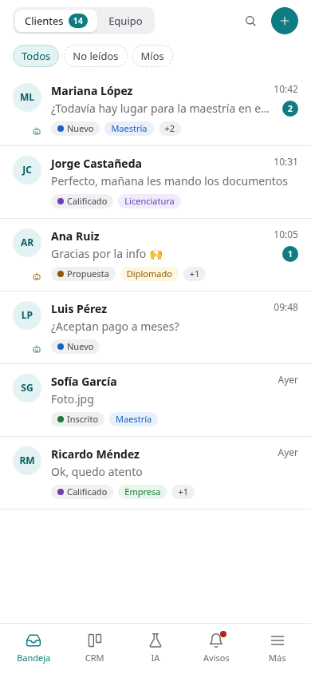
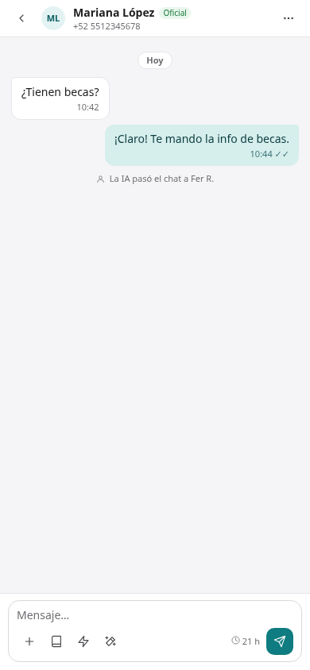
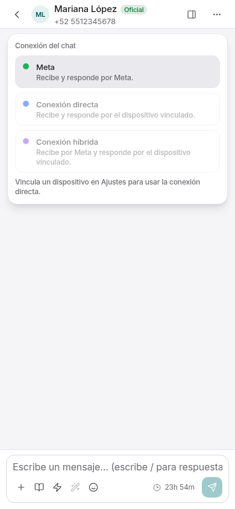
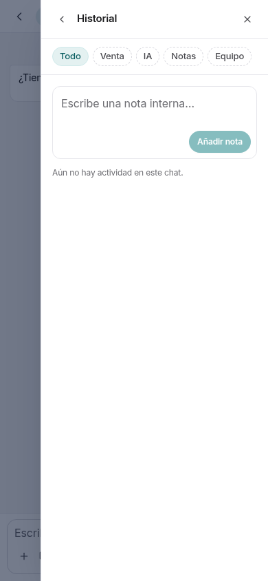

# T2 · móvil Clásico y claro

Referencia principal: [ronda 3, lámina 42: Celular · Bandeja, chat y Avisos](../../maquetas/ronda3/42-movil.png), confirmada por la imagen aportada en la revisión.
También se consultaron el [PDF](../../maquetas/ronda3/dashfort-redisenio-ronda3.pdf),
[el prototipo de ronda 3](../../maquetas/ronda3/prototipo-ronda3.html),
[movil-despues.png](../../maquetas/movil-despues.png),
[sus notas](../../maquetas/movil-despues-notas.png) y
[el prototipo Clásico claro](../../maquetas/prototipo-clasico-claro.html).

Las referencias siguientes se renderizan desde el HTML original a **390 × 844 px**,
sin el marco del teléfono ni la barra de estado del sistema. La aplicación se
captura a esa misma medida y escala 1, con interfaz y chat **Clásico**, tema
**Claro**, base local de demostración y proveedores simulados. Los nombres,
mensajes, cantidades y módulos de la demostración difieren de la maqueta.

| Referencia · ronda 3, lámina 42 | Implementación · 390 px |
| --- | --- |
|  |  |
|  |  |

Comparaciones listas para revisar:
[Bandeja](comparacion-bandeja-390.png) · [Chat](comparacion-chat-390.png).
Se incluyen también las versiones HTML de ambas comparaciones.

| Guía visual | Captura móvil |
| --- | --- |
| [Conexión: etiqueta tenue junto al nombre y selector](../../maquetas/ronda3/02-conexion-opciones.png) |  |
| [Historial desde «⋯»](../../maquetas/ronda3/03-historial.png) |   |
| [Navegación y tarjetas de ronda 3](../../maquetas/ronda3/01-bandeja.png) |  |
| [Listas y tarjetas de Ajustes](../../maquetas/ronda3/26-canales-conectar.png) |  |

La lámina 42 no incluye pantallas móviles dedicadas para Más y Ajustes: se
adaptan las listas y tarjetas del mismo sistema visual, con márgenes simétricos
y ancho completo. Los destinos de la barra inferior siguen los de #211 y los
módulos disponibles; no se sustituyen por los destinos ilustrativos de la lámina.
Se mantienen los nombres accesibles y las acciones existentes, incluido el
acceso a Detalles del encabezado.

## Comprobaciones

- Los cinco chips (Todos, No leídos, Míos, Campañas, Grupos) comparten una fila
  con desplazamiento horizontal. Grupos utiliza el soporte integrado en #212 y
  conserva la condición existente de Conexión directa habilitada.
- [Estado del filtro Grupos](grupos-390.png).
- El compositor vacío es compacto, conserva sus herramientas y queda dentro
  de la pantalla. Los textos escritos pueden crecer y envolver normalmente.
- El selector de conexión cabe en 390 px y «Ver historial» abre la actividad.
- [Escritorio a 1440 px](escritorio-1440.png): las capturas son idénticas al
  eliminar las reglas móviles de T2 ([resultado](verificacion-escritorio.txt)).

Con la app LOCAL compilada, los mocks encendidos y el usuario e2e de la base de
prueba, los comandos son:

```sh
PLAYWRIGHT_CHROMIUM=/usr/bin/chromium node --env-file=.env scripts/e2e-responsive.mjs
PLAYWRIGHT_CHROMIUM=/usr/bin/chromium node --env-file=.env scripts/capture-t2-mobile.mjs
```

El segundo comando requiere Conexión directa habilitada en la organización de
prueba para comprobar los cinco chips y la etiqueta de conexión. No siembra ni
envía mensajes; solo accede a los datos de prueba y recorre la interfaz.
`--references-only` permite regenerar únicamente las capturas del prototipo.
