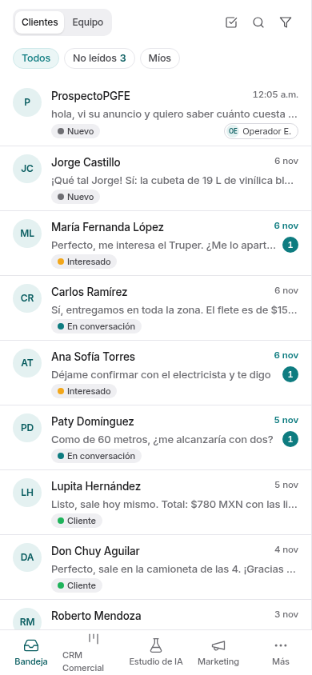
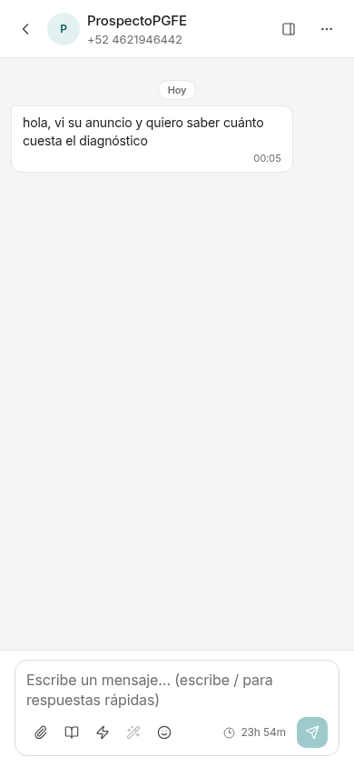
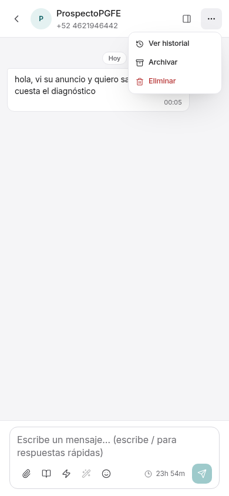
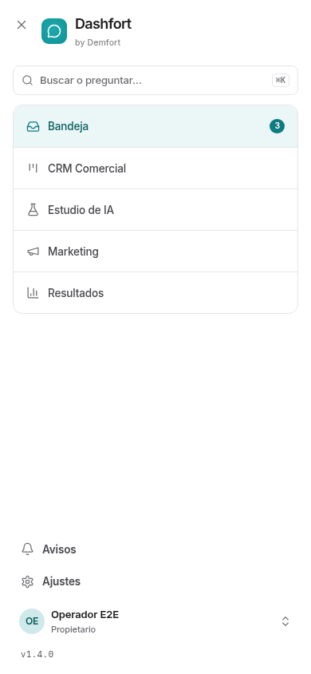
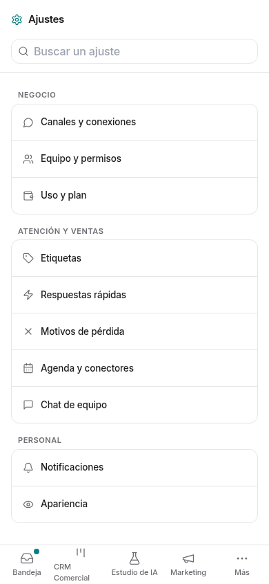

# T2 · revisión móvil

Capturas de la aplicación real a **390 × 844 px**, escala 1, interfaz y chat
**Clásico**, tema **Claro**. Base local de demostración y proveedores simulados;
no hay datos de clientes ni conexiones de producción.

| Vista | Captura a 390 px | Referencia |
| --- | --- | --- |
| Lista de chats |  | Pendiente de recibir `movil-despues.png` |
| Chat |  | Pendiente de recibir `movil-despues.png` |
| Opciones del chat |  | Pendiente de recibir `movil-despues-notas.png` |
| Más |  | Pendiente de recibir las maquetas |
| Ajustes |  | Pendiente de recibir las maquetas y el PDF de ronda 3 |

Las rutas de referencia indicadas en T2 no existen en el checkout de `main`:
`auditoria-diseno/maquetas/`, `maquetas/ronda3/` y
`prototipo-clasico-claro.html`. Esta tabla **no certifica fidelidad a las maquetas**;
falta colocar cada referencia junto a su captura y ajustar las diferencias.

También falta resolver el chip **Grupos**: `main` no ofrece ese filtro en la
Bandeja de clientes. T2 conserva la lógica actual y no incorpora la rama
`feat/whatsapp-groups`.

## Comprobación funcional

Con la app y los mocks locales encendidos:

```sh
PLAYWRIGHT_CHROMIUM=/usr/bin/chromium node --env-file=.env scripts/e2e-responsive.mjs
```

Recorre teléfono (390 px), tableta (820 px) y escritorio (1440 px), comprueba
recortes, menú, búsqueda, chips, historial, compositor, detalles y temas.
Las capturas del recorrido se generan en `scratch/responsive/`.

[Captura de escritorio a 1440 px](escritorio-1440.png).
[Comparación de escritorio con las reglas T2 eliminadas](verificacion-escritorio.txt).
